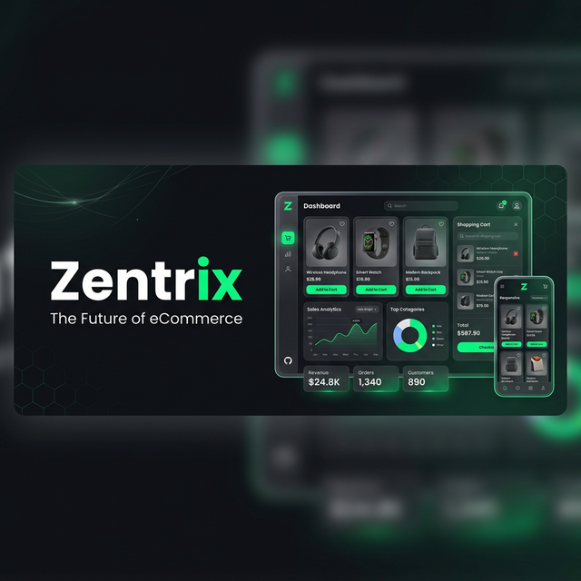
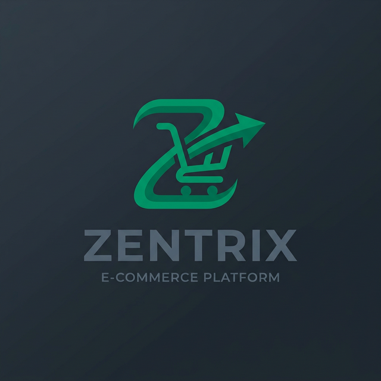
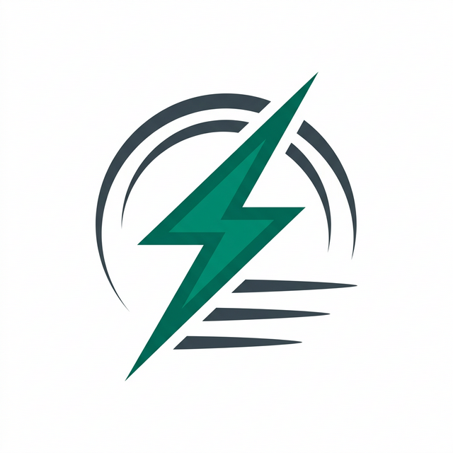
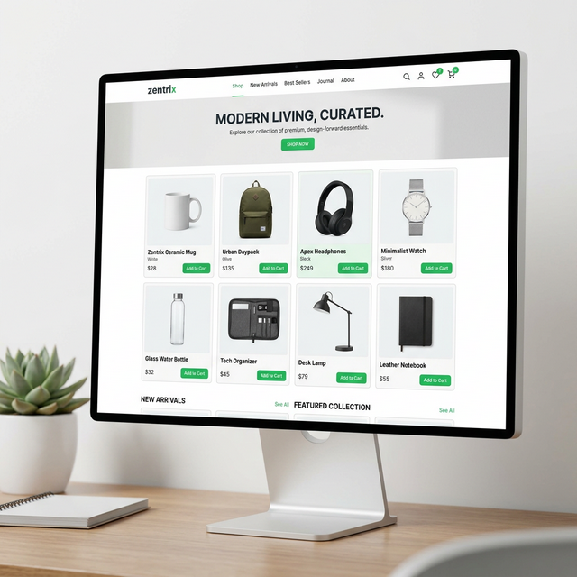
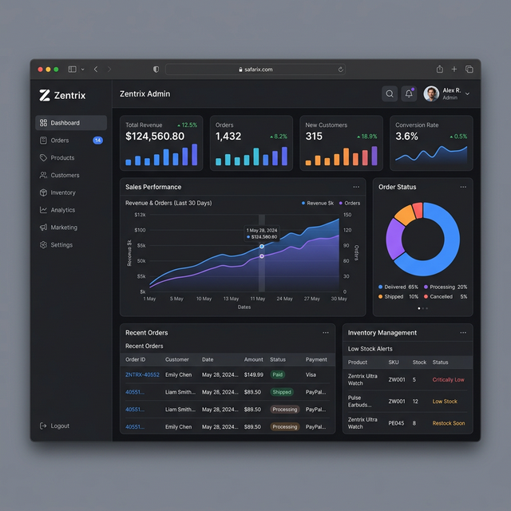

<p align="center">
  
</p>

<p align="center">
  
</p>

<h1 align="center">Zentrix</h1>

<p align="center">
  <strong>The Future of High-Performance, Modular eCommerce</strong><br />
  Built with TypeScript, React, and GraphQL for developers who demand excellence.
</p>

<p align="center">
  <a href="https://zentrix.io/docs/development/getting-started/introduction"><strong>Documentation</strong></a> |
  <a href="https://demo.zentrix.io/"><strong>Live Demo</strong></a> |
  <a href="https://discord.gg/GSzt7dt7RM"><strong>Community</strong></a>
</p>

<p align="center">
  
  <a href="https://twitter.com/zentrixjs"></a>
  <a href="https://discord.gg/GSzt7dt7RM"></a>
  <a href="https://opensource.org/licenses/GPL-3.0"></a>
</p>

---

## ⚡ What is Zentrix?

**Zentrix** is a modern, TypeScript-first eCommerce platform designed for speed, flexibility, and developer happiness. It leverages a modular architecture that allows you to swap themes, extend logic, and scale with confidence.

- 🚀 **Performance First**: Optimized for core web vitals and rapid response times.
- 🧩 **Modular Architecture**: Fully customizable via extensions and themes.
- 🛡️ **TypeScript-First**: Type-safe development across the entire stack.
- 🕸️ **Headless & GraphQL**: Decoupled frontend with a powerful GraphQL API.

---

## 🏗️ Core Features

<table width="100%">
  <tr>
    <td width="50%" align="center">
      <br />
      <strong>Fully Modular</strong><br />
      Hook into any part of the lifecycle with a robust plugin system.
    </td>
    <td width="50%" align="center">
      <br />
      <strong>Blazing Fast</strong><br />
      Built on a stack that prioritizes speed and low latency.
    </td>
  </tr>
</table>

---

## 🖼️ Experience Zentrix

### Storefront Preview
Explore a world-class shopping experience out of the box.

<p align="center">
  
</p>

### Admin Dashboard
Manage your store with a professional, data-driven interface.

<p align="center">
  
</p>

---

## 🚀 Quick Start (Docker)

Get up and running in seconds:

```bash
# Download the compose file
curl -sSL https://raw.githubusercontent.com/zentrixcommerce/zentrix/main/docker-compose.yml > docker-compose.yml

# Start the platform
docker compose up -d
```

> [!TIP]
> For manual installation and detailed guides, check our [Installation Documentation](https://zentrix.io/docs/development/getting-started/installation-guide).

---

## 🎮 Explore Our Live Demos

| Site | Link | Credentials |
| :--- | :--- | :--- |
| **Storefront** | [demo.zentrix.io](https://demo.zentrix.io/) | No Login Required |
| **Admin** | [demo.zentrix.io/admin](https://demo.zentrix.io/admin) | `demo@zentrix.io` / `123456` |

---

## 🤝 Community & Support

- ⭐ **Star this repository** to support our growth!
- 🐛 **[Report a bug](https://github.com/zentrixcommerce/zentrix/issues/new)** or request a feature.
- 💬 Join the **[Discord Community](https://discord.gg/GSzt7dt7RM)** for real-time help.

## 🚀 The Future of Zentrix

We are actively building **Zentrix Cloud**. If you're an investor or partner interested in modern eCommerce, we’d love to connect.

📩 **Contact Us:** [support@zentrix.io](mailto:support@zentrix.io)

---

## 📄 License

Distributed under the **GPL-3.0 License**. See `LICENSE` for more information.

<p align="center">Made with ❤️ for the Developer Community</p>

